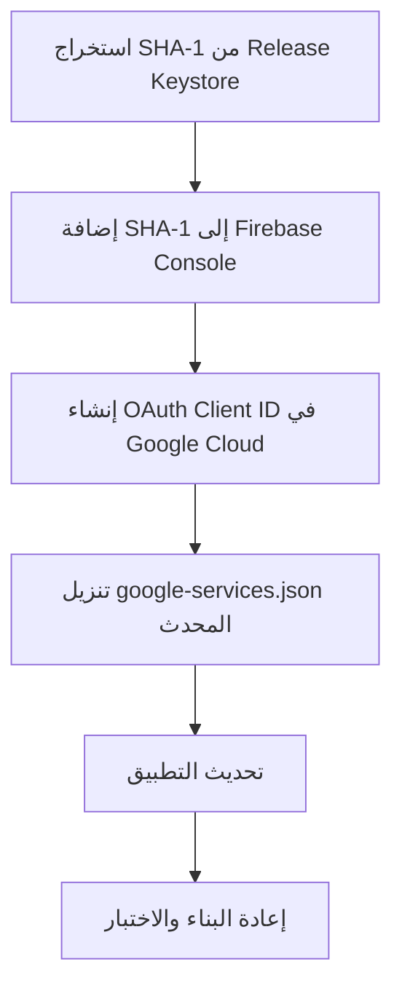

# 🔐 دليل إصلاح Google Sign-In في نسخة Release

> **التاريخ:** 2026-02-06  
> **المشروع:** hggzk_app  
> **المشكلة:** Google Sign-In يعمل في Debug ولكن لا يعمل في Release

---

## 📋 جدول المحتويات

1. [التشخيص](#-التشخيص)
2. [السبب الجذري](#-السبب-الجذري)
3. [الحل الكامل](#-الحل-الكامل)
4. [الخطوات التفصيلية](#-الخطوات-التفصيلية)
5. [التحقق من الإصلاح](#-التحقق-من-الإصلاح)
6. [استكشاف الأخطاء](#-استكشاف-الأخطاء)

---

## 🔍 التشخيص

### المعلومات المكتشفة

| العنصر | القيمة | الحالة |
|--------|--------|---------|
| **Debug SHA-1** | `c611843731bc9123aa706fb5aae5c7a77bcad198` | ✅ يعمل |
| **Firebase SHA-1** | `1ae2f2c5930fb3dae4192d11909440f4375db075` | ⚠️ غير معروف المصدر |
| **Release SHA-1** | ❓ غير محدد | ❌ غير مسجل |

### النتيجة

```
Debug Mode  ✅ → يستخدم debug.keystore → يحتمل أن SHA-1 مسجل في Firebase
Release Mode ❌ → يستخدم my-release-key.jks → SHA-1 غير مسجل → Google Sign-In يفشل
```

---

## ⚠️ السبب الجذري

### كيف يعمل Google Sign-In على Android؟

1. عند طلب تسجيل الدخول، يرسل التطبيق **Package Name** و **SHA-1 Certificate**
2. Google يتحقق من أن هذا الزوج (Package + SHA-1) مسجل في **Firebase Console**
3. إذا لم يكن مسجلاً، يُرفض الطلب ويظهر خطأ `DEVELOPER_ERROR` أو `API_NOT_CONNECTED`

### لماذا يعمل في Debug وليس في Release؟

```
Debug Build:
  → التوقيع: ~/.android/debug.keystore (ثابت)
  → SHA-1: c611843731bc9123aa706fb5aae5c7a77bcad198
  → Firebase: قد يكون مسجلاً بالصدفة أو عن طريق الخطأ

Release Build:
  → التوقيع: android/app/my-release-key.jks (مخصص)
  → SHA-1: ??? (غير معروف)
  → Firebase: ❌ غير مسجل
  → النتيجة: Google Sign-In يفشل
```

---

## ✅ الحل الكامل

### نظرة عامة



### الأدوات المطلوبة

- ✅ وصول إلى [Firebase Console](https://console.firebase.google.com)
- ✅ وصول إلى [Google Cloud Console](https://console.cloud.google.com)
- ✅ كلمة مرور الـ Release Keystore
- ✅ Java keytool (مثبت مع JDK)

---

## 📝 الخطوات التفصيلية

### الخطوة 1: استخراج SHA-1 من Release Keystore

#### الطريقة الأولى: باستخدام keytool

```bash
# الانتقال إلى مجلد المشروع
cd /home/ameen/Desktop/BOOKIN/BOOKIN/hggzk_app/android

# استخراج SHA-1
keytool -list -v -keystore app/my-release-key.jks -alias key0
```

**ستُطلب كلمة المرور.** جرّب:
- `hggzk@2024`
- `hggzk123@`
- `hggzk2024`

**المخرجات المتوقعة:**
```
Certificate fingerprints:
	 SHA1: XX:XX:XX:XX:XX:XX:XX:XX:XX:XX:XX:XX:XX:XX:XX:XX:XX:XX:XX:XX
	 SHA256: YY:YY:...
```

**احفظ SHA-1** (سنحتاجه في الخطوة التالية)

#### الطريقة الثانية: باستخدام السكريبت الجاهز

```bash
cd /home/ameen/Desktop/BOOKIN/BOOKIN
./fix_google_signin_release.sh
```

#### الطريقة الثالثة: إذا نسيت كلمة المرور

**⚠️ إذا كنت لا تملك كلمة المرور:**

1. **إنشاء keystore جديد:**
   ```bash
   cd /home/ameen/Desktop/BOOKIN/BOOKIN/hggzk_app/android
   
   keytool -genkey -v -keystore app/release-new.jks \
     -keyalg RSA -keysize 2048 -validity 10000 \
     -alias hggzk-release \
     -storepass "YourNewPassword123!" \
     -keypass "YourNewPassword123!"
   ```

2. **تحديث build.gradle.kts** ليشير إلى الـ keystore الجديد

3. **⚠️ مهم:** سيحتاج هذا إلى إعادة نشر التطبيق على Google Play Console

---

### الخطوة 2: إضافة SHA-1 إلى Firebase Console

#### 2.1 فتح Firebase Console

1. افتح [Firebase Console](https://console.firebase.google.com)
2. اختر مشروع **hggzk-67002**

#### 2.2 الانتقال إلى إعدادات التطبيق

1. اضغط على ⚙️ (Settings) → **Project settings**
2. مرّر لأسفل إلى قسم **Your apps**
3. ابحث عن تطبيق Android:
   ```
   📱 com.hggzk.app
   ```

#### 2.3 إضافة SHA-1

1. اضغط على تطبيق **com.hggzk.app**
2. مرّر إلى قسم **SHA certificate fingerprints**
3. اضغط على **Add fingerprint**
4. الصق **SHA-1** الذي استخرجته (بدون مسافات أو نقطتين)
   ```
   مثال: 1ae2f2c5930fb3dae4192d11909440f4375db075
   ```
5. اضغط **Save**

#### 2.4 تنزيل google-services.json المحدث

1. في نفس الصفحة، اضغط على **Download google-services.json**
2. احفظ الملف

---

### الخطوة 3: إنشاء OAuth 2.0 Client ID

#### 3.1 فتح Google Cloud Console

1. افتح [Google Cloud Console - Credentials](https://console.cloud.google.com/apis/credentials)
2. تأكد من اختيار المشروع **hggzk-67002**

#### 3.2 التحقق من Client IDs الموجودة

ابحث عن OAuth Client IDs من نوع **Android**:

| Client ID | Package | SHA-1 |
|-----------|---------|-------|
| `333370677136-834ocmm2shmri6v2b7cjpph58nttt9k4` | com.hggzk.app | `1ae2f2c5...` |

#### 3.3 تحديث أو إنشاء Client ID

**الخيار أ: تحديث Client ID الموجود**

1. اضغط على ✏️ بجانب Client ID الموجود
2. أضف SHA-1 الجديد إلى القائمة
3. احفظ التغييرات

**الخيار ب: إنشاء Client ID جديد**

1. اضغط **+ CREATE CREDENTIALS** → **OAuth client ID**
2. اختر **Application type:** Android
3. أدخل:
   - **Name:** `hggzk Android (Release)`
   - **Package name:** `com.hggzk.app`
   - **SHA-1 certificate fingerprint:** (الصق SHA-1)
4. اضغط **Create**
5. **احفظ Client ID** الجديد

---

### الخطوة 4: تحديث المشروع

#### 4.1 استبدال google-services.json

```bash
cd /home/ameen/Desktop/BOOKIN/BOOKIN/hggzk_app

# نسخة احتياطية للملف القديم
cp android/app/google-services.json android/app/google-services.json.backup

# استبدال بالملف الجديد
cp ~/Downloads/google-services.json android/app/google-services.json
```

#### 4.2 تحديث app_constants.dart (إذا لزم الأمر)

افتح [`lib/core/constants/app_constants.dart`](./lib/core/constants/app_constants.dart):

```dart
// تأكد من أن Client IDs صحيحة
static const String googleWebClientId =
    '333370677136-el3bpb5fn4tt8qrcr52v8r59h4fko283.apps.googleusercontent.com';
    
static const String googleAndroidClientId =
    '333370677136-834ocmm2shmri6v2b7cjpph58nttt9k4.apps.googleusercontent.com';
    // ⚠️ قد تحتاج تحديث هذا إذا أنشأت Client ID جديد
```

#### 4.3 تنظيف وإعادة البناء

```bash
cd /home/ameen/Desktop/BOOKIN/BOOKIN/hggzk_app

# تنظيف
flutter clean

# إعادة تحميل Dependencies
flutter pub get

# بناء Release APK
flutter build apk --release

# أو بناء App Bundle
flutter build appbundle --release
```

---

## 🧪 التحقق من الإصلاح

### 1. تثبيت النسخة على جهاز حقيقي

```bash
# تثبيت Release APK
flutter install --release

# أو يدويًا
adb install build/app/outputs/flutter-apk/app-release.apk
```

### 2. مراقبة Logs أثناء التسجيل

```bash
# فتح logcat في terminal منفصل
adb logcat | grep -E "GoogleSign|OAuth|AuthBloc|social"
```

### 3. اختبار Google Sign-In

1. افتح التطبيق
2. اذهب إلى صفحة تسجيل الدخول
3. اضغط على **تسجيل الدخول بـ Google**
4. اختر حساب Google

### 4. النتائج المتوقعة

#### ✅ **نجح الإصلاح:**

```
✅ Google Sign-In: بدء عملية تسجيل الدخول...
✅ Google Sign-In: تم الحصول على الحساب: user@gmail.com
✅ التحقق من الـ Tokens...
   - ID Token: ✅ موجود
   - Access Token: ✅ موجود
✅ Google Sign-In: إرسال idToken إلى الخادم...
✅ تم تسجيل الدخول بنجاح
```

#### ❌ **مازال يفشل:**

```
❌ Google Sign-In error: DEVELOPER_ERROR
❌ Sign in failed: ApiException: 10
```

→ انتقل إلى [استكشاف الأخطاء](#-استكشاف-الأخطاء)

---

## 🔧 استكشاف الأخطاء

### المشكلة 1: DEVELOPER_ERROR

**الأعراض:**
```
PlatformException(sign_in_failed, com.google.android.gms.common.api.ApiException: 10: , null, null)
```

**الحلول:**

1. **تحقق من SHA-1:**
   ```bash
   # استخرج SHA-1 من APK المثبت
   keytool -printcert -jarfile build/app/outputs/flutter-apk/app-release.apk
   ```
   
2. **تحقق من google-services.json:**
   - افتح `android/app/google-services.json`
   - تأكد من وجود `certificate_hash` يطابق SHA-1

3. **تحقق من Package Name:**
   ```bash
   # من android/app/build.gradle.kts
   grep "applicationId" android/app/build.gradle.kts
   # يجب أن يكون: com.hggzk.app
   ```

4. **انتظر 5-10 دقائق** بعد تحديث Firebase

---

### المشكلة 2: API_NOT_CONNECTED

**الأعراض:**
```
Google Sign-In: لا يوجد token صالح!
```

**الحلول:**

1. **تحقق من Google Play Services:**
   ```bash
   # تحديث Google Play Services على الجهاز
   adb shell pm list packages | grep google
   ```

2. **تحقق من serverClientId:**
   - في [`social_login_buttons.dart`](./lib/features/auth/presentation/widgets/social_login_buttons.dart)
   - تأكد من استخدام Web Client ID كـ serverClientId

---

### المشكلة 3: Token صحيح لكن Backend يرفض

**الأعراض:**
```
✅ Google Sign-In: تم الحصول على token
❌ Backend API: فشل تسجيل الدخول الاجتماعي
```

**الحلول:**

1. **تحقق من Backend API:**
   ```bash
   # اختبار endpoint يدويًا
   curl -X POST https://api.hggzk.com/api/client/auth/social-login \
     -H "Content-Type: application/json" \
     -d '{"provider":"google","token":"YOUR_ID_TOKEN"}'
   ```

2. **تحقق من Google Client IDs في Backend:**
   - افتح [`YemenBooking.Application_New/Features/Authentication/Services/SocialAuthService.cs`](../../backend/YemenBooking.Application_New/Features/Authentication/Services/SocialAuthService.cs)
   - تأكد من أن Google Client IDs تطابق Firebase

---

## 📚 مراجع ومصادر

### الوثائق الرسمية

- [Firebase Android Setup](https://firebase.google.com/docs/android/setup)
- [Google Sign-In for Android](https://developers.google.com/identity/sign-in/android/start-integrating)
- [OAuth 2.0 for Android](https://developers.google.com/identity/protocols/oauth2/native-app)

### أدوات مفيدة

- [Firebase Console](https://console.firebase.google.com)
- [Google Cloud Console](https://console.cloud.google.com)
- [SHA-1 Checker](https://developers.google.com/android/guides/client-auth)

### الملفات ذات الصلة في المشروع

| الملف | الموقع | الوصف |
|------|--------|-------|
| `google-services.json` | `android/app/` | إعدادات Firebase |
| `build.gradle.kts` | `android/app/` | إعدادات Signing |
| `app_constants.dart` | `lib/core/constants/` | OAuth Client IDs |
| `social_login_buttons.dart` | `lib/features/auth/presentation/widgets/` | تنفيذ Google Sign-In |
| `auth_remote_datasource.dart` | `lib/features/auth/data/datasources/` | API Calls |

---

## ✨ ملخص سريع

```bash
# 1. استخراج SHA-1
keytool -list -v -keystore android/app/my-release-key.jks -alias key0

# 2. إضافة SHA-1 إلى Firebase Console
# (عبر الواجهة الرسومية)

# 3. تنزيل google-services.json المحدث

# 4. تحديث المشروع
cp ~/Downloads/google-services.json android/app/google-services.json

# 5. إعادة البناء
flutter clean
flutter pub get
flutter build apk --release

# 6. الاختبار
flutter install --release
adb logcat | grep -i google
```

---

## 🆘 المساعدة والدعم

إذا واجهت مشاكل:

1. **راجع Logs بعناية:**
   ```bash
   adb logcat | grep -E "GoogleSign|OAuth|social" > debug.log
   ```

2. **تحقق من Firebase Console:**
   - SHA-1 مضاف بشكل صحيح؟
   - google-services.json محدث؟

3. **تحقق من Google Cloud Console:**
   - OAuth Client ID موجود؟
   - Package name صحيح؟
   - SHA-1 صحيح؟

---

**آخر تحديث:** 2026-02-06  
**الإصدار:** 1.0.1+21
